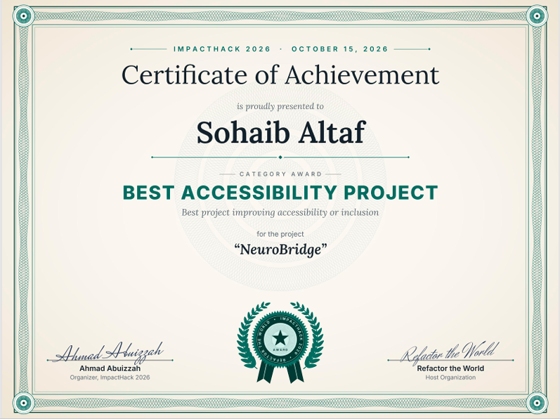

# 🧠 NeuroBridge — Adaptive Learning & Accessibility Copilot

[](https://github.com/SohaibAltaf135/Neurobridge)

> **🏆 Winner: Best Accessibility Project — ImpactHack 2026** *(Refactor the World)*  
> *Transforming dense, intimidating textbooks and lecture slides into dyslexia-friendly, ADHD-adapted, multi-sensory study experiences.*

<p align="center">
  
</p>

---

## 💡 The Problem

Over **15–20% of students** live with learning differences like ADHD, dyslexia, or executive dysfunction. For these students, traditional education presents severe cognitive hurdles:
1. **Visual Crowding & Letter Confusion (Dyslexia)**: Traditional textbook typography causes words to swim, crowd, or blur, inducing rapid fatigue and headaches.
2. **Executive Paralysis (ADHD)**: Looking at a 10-page chapter triggers attention freeze. Students don't know where to begin, attention drifts after two sentences, and anxiety builds.
3. **Impenetrable Academic Jargon**: Textbooks describe concepts in robotic language without intuitive mental anchors or relatable analogies.
4. **Existing AI Tools Fall Short**: Standard chatbots (like ChatGPT) reply with *yet another intimidating wall of text*, failing to adapt to how neurodivergent brains process information.

---

## 🚀 The Solution: NeuroBridge

**NeuroBridge** takes messy textbook photos, slides, or pasted notes and instantly restructures the knowledge into an adaptive, multi-sensory learning dashboard:

* 📖 **Bionic Reading & Dyslexia Typography**: Automatically bolds saccadic fixation points (first 30-50% of words) so eyes glide effortlessly. Features **OpenDyslexic** and **Lexend** fonts, line-height adjustments, and soothing background tints (warm cream, soft Irlen yellow, mint green) to reduce visual stress.
* 👁️ **Cursor-Guided Reading Ruler**: A mouse-following horizontal focus bar that keeps eyes locked on the current sentence, preventing accidental line jumping.
* 🗺️ **Interactive Visual Mind Map**: Generates dynamic, clickable SVG concept webs connecting core subjects, sub-concepts, details, and examples for visual learners.
* ⏱️ **ADHD Executive Action Plan & Micro-Missions**: Cures study paralysis by breaking complex topics into bite-sized **3–5 minute micro-sprints** with a built-in focus timer and confetti gamification.
* 🔊 **Audio Voice Narration (Text-to-Speech)**: Integrated speech synthesis with adjustable pacing (0.5x–1.5x) for auditory processing needs.
* 🃏 **Active Recall & Low-Stress Quiz**: 3D flip cards with **mnemonic memory anchors** and a 3-question self-check quiz with instant constructive explanations.
* 🤖 **Empathetic AI Tutor Copilot**: Powered by **Google Gemini 2.5 Flash**, the AI tutor answers follow-up questions using video game analogies and real-world metaphors.

---

## 🛠️ Tech Stack & Architecture

- **Frontend**: React 19, TypeScript, Vite
- **Styling & Accessibility**: Tailwind CSS, OpenDyslexic typography, Web Speech API
- **Visuals & Gamification**: Interactive SVG graph engine, Canvas-Confetti, Lucide Icons
- **AI Core**: Google Gemini 2.5 Flash (`@google/genai` / Gemini REST API)
  - Multimodal Vision (extracts diagrams and handwritten notes from textbook photos)
  - Structured JSON Schemas (mind map graphs, micro-tasks, flashcard decks)
  - Contextual Tutoring (empathetic follow-up dialogue)

---

## ⚡ Quick Start / Local Installation

### Prerequisites
- Node.js (v18 or newer)
- npm or yarn

### 1. Clone & Install
```bash
git clone https://github.com/SohaibAltaf135/Neurobridge.git
cd Neurobridge
npm install
```

### 2. Start the Development Server
```bash
npm run dev
```
Open [http://localhost:3000](http://localhost:3000) in your web browser.

### 3. (Optional) Configure Gemini API Key
Click **"Enter Gemini Key"** in the top navigation bar and paste your Google Gemini API key from [Google AI Studio](https://aistudio.google.com/app/apikey).  
*(NeuroBridge also includes a built-in local text synthesizer and interactive biology/physics demo scenarios that run 100% offline with zero setup!)*

---

## 🏆 Awards & Recognition

- 🥇 **Winner: Best Accessibility Project** — *ImpactHack 2026 (October 15, 2026)*  
  *Awarded to **Sohaib Altaf** by Refactor the World for the best project improving accessibility or inclusion.*

---

## 📜 License
MIT License. Built with ❤️ by **Sohaib Altaf** for students everywhere.
